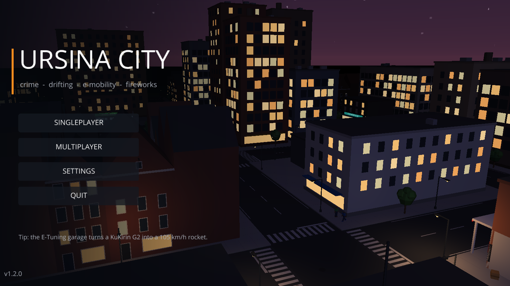
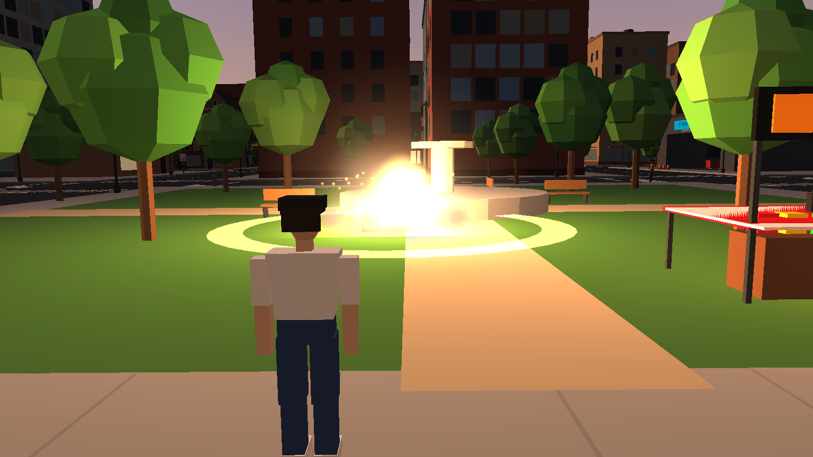
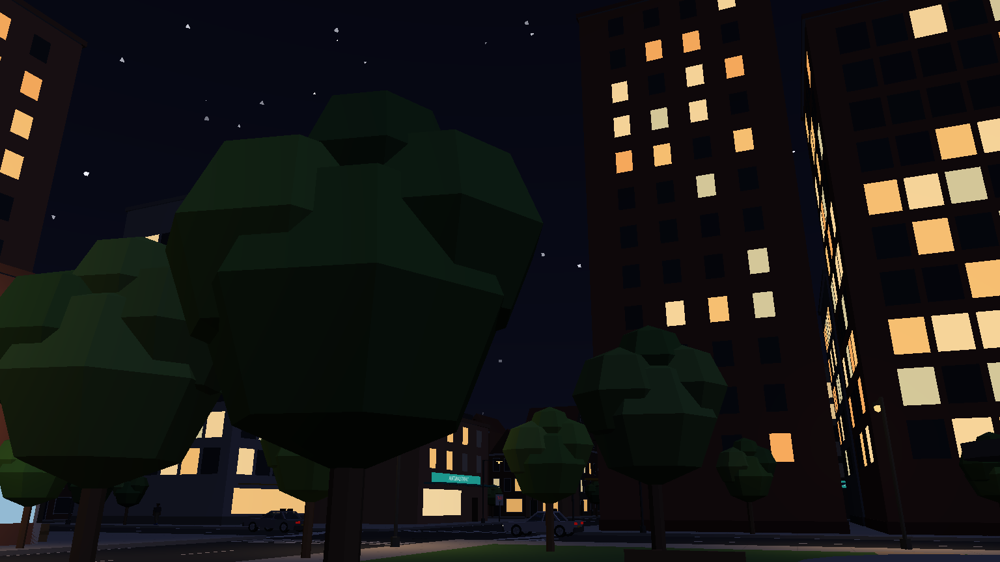
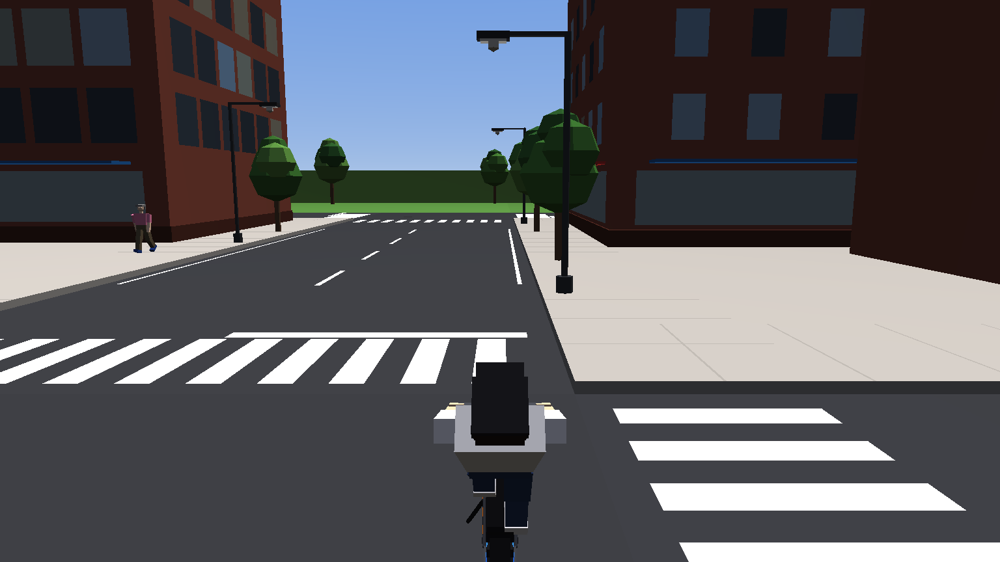

<div align="center">

# 🏙️ URSINA CITY

**An open-world crime & vehicle sandbox written in pure Python with the [Ursina](https://www.ursinaengine.org/) engine.**

Drift through a low-poly city, pull wheelies on a KuKirin G2, tune your e-scooter, rob stores,
throw heavy fireworks and play with friends using just a room code.




</div>

---

## 📸 Screenshots

<table>
  <tr>
    <td width="50%"><br><sub><b>Fireworks</b> - a Cobra 6 goes off in the park, with flash, shockwave and smoke.</sub></td>
    <td width="50%"><br><sub><b>Day / night cycle</b> - windows and streetlights light up when the sun goes down.</sub></td>
  </tr>
  <tr>
    <td width="50%"><br><sub><b>KuKirin G2</b> - a standing e-scooter you can tune and pull wheelies on.</sub></td>
    <td width="50%"><br><sub><b>Live main menu</b> - the camera flies over the city while traffic drives and fireworks pop.</sub></td>
  </tr>
</table>

> Every model, shader and sound effect is generated by code when the game starts: no downloads, no asset packs.

---

## 🚀 Quick start (Windows)

1. Click the green **Code** button above, then **Download ZIP**, and unzip it anywhere.
2. Double-click **`START_GAME.bat`**.
   - It installs Python and the libraries automatically if you don't have them.
   - It checks this repository for updates every time it starts.
3. Choose **SINGLEPLAYER** and have fun. Press **F1** in game for all controls.

Prefer the terminal?

```bash
pip install ursina numpy
python main.py
```

---

## ✨ Features

| | |
|---|---|
| 🚗 **Arcade drift physics** | Handbrake drifts, power-over, counter-steering, burnouts and donuts, tyre marks and smoke. Long clean drifts build a combo meter that pays cash. |
| 🛴 **E-mobility** | E-scooter, e-motorbike and the **KuKirin G2** standing e-scooter, all with leaning physics, battery, range and boost. |
| 🤸 **Manual wheelies** | Hold **CTRL** to lift the front wheel. There is no auto-balance: feather it, or you loop it and fall off. |
| 🔧 **E-Tuning garage** | Upgrade motor wattage (up to 8000 W / 105 km/h), battery, suspension, and frame + accent paint. |
| 🎆 **Fireworks** | **Cobra 6** (short fuse, huge bang) and **Scream 100** (2 s screaming spark fountain, then a massive bang), with knockback on people, cars and props. |
| 💰 **Crime & money** | Rob 5 different stores, buy and upgrade 5 businesses for passive income, courier runs, checkpoint time trials. |
| 🚓 **Police & wanted level** | Up to 3 stars, police chases with sirens, get BUSTED if they box you in. |
| 🚶 **Living city** | Pedestrians walk, cross at zebra crossings and flee; NPC traffic follows the roads; a full day/night cycle. |
| 🌐 **Multiplayer** | Host a room and share a **5-letter code**. Works on the same Wi-Fi and over the internet, no IP addresses or port forwarding. |
| 🔄 **Auto-updater** | `START_GAME.bat` / `UPDATE.bat` update your files from this repo in place. Your savegame is never touched. |

---

## 🎮 Controls

| Key | On foot | In a vehicle |
|---|---|---|
| **W A S D** | Walk | Drive / steer |
| **Shift** | Sprint | Boost (e-vehicles) |
| **Space** | Jump | Handbrake / drift |
| **Ctrl** | | Wheelie (two-wheelers) |
| **E** | Enter / steal / carjack, interact | Get out |
| **Left click** | Throw firework | Throw firework |
| **Tab** (hold) | Weapon wheel | Weapon wheel |
| **1 / 2 / 3** | Hands / Cobra 6 / Scream 100 | |
| **B** | Buy a snack in a shop | |
| **Q** | | Re-open the tuning menu on the pad |
| **H / R** | | Horn / reset vehicle |
| **V** | First / third person | Cockpit / chase camera |
| **T** | Toggle day / night | |
| **F12** | Screenshot (no HUD) | Screenshot |
| **Esc** | Pause, then Main menu | |
| **F9** | One-time +5,000 coin bonus | |

---

## 🌐 Multiplayer

1. One player opens **MULTIPLAYER → CREATE & HOST**. The game shows a room code like `K7MQ2`.
2. Friends open **MULTIPLAYER**, type the code, and press **JOIN**.

- **PUBLIC** rooms also appear in the room list, so people can click to join.
- **PRIVATE** rooms are hidden, and only people with the code can join.
- On the same Wi-Fi players connect directly. Over the internet, the game uses a free public relay server (MQTT), so no router setup is needed.
- You see each other's characters, cars, scooters, wheelies and fireworks in real time. Traffic, pedestrians and police are local to each player.

---

## 🔄 Updating

- **`START_GAME.bat`** checks for a new version before every launch.
- **`UPDATE.bat`** only checks and updates, then asks if you want to play.

Both download only the changed files into your current folder. `savegame.json` is never touched, and details are written to `update_log.txt`.

**For the developer:** to release an update, edit the files, raise `"version"` in `version.json`, and upload them to this repo. Files listed under `"remove"` in `version.json` are deleted from players' folders.

---

## 📁 Project structure

```
main.py             game loop, input, pause menu, settings, screenshots
world.py            city generation, lighting shaders, day/night, particles, sound synthesis, collision
player.py           player movement, jump, camera, HUD and minimap
vehicles.py         cars with drift physics, e-scooters / e-motorbikes / KuKirin G2, wheelies
npcs.py             pedestrians, traffic AI, police chases, wanted level
items_and_shops.py  fireworks, robberies, businesses, tuning garage, courier runs, time trials
menus.py            main menu, settings, multiplayer room browser
network.py          code-only multiplayer (Wi-Fi + internet relay)
updater.py          GitHub self-updater
START_GAME.bat      installer + updater + launcher
UPDATE.bat          update only
version.json        current version, files to download, files to remove
docs/               screenshots for this page
```

---

<div align="center">
<sub>Made with Python & Ursina. All 3D models, shaders and sounds are procedurally generated.</sub>
</div>
